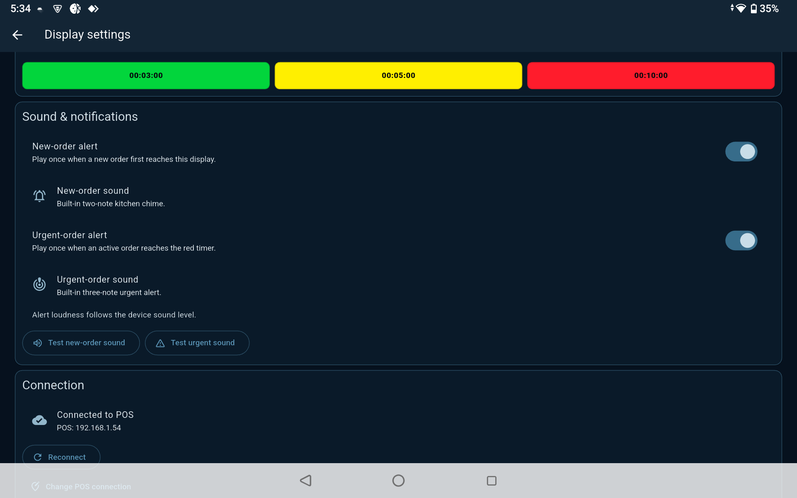

# Mysztech Order Display (ODS)

Mysztech ODS is a Flutter kitchen display system (KDS). It pairs a display with
a Mysztech POS on the outlet LAN, receives kitchen orders over a WebSocket, and
renders them as large, timer-driven kitchen receipts.



## Start here

The full, implementation-based reference is in
[`docs/PROJECT_GUIDE.md`](docs/PROJECT_GUIDE.md). It covers the architecture,
pairing and order protocol, data storage, feature behaviour, project structure,
development workflow, deployment notes, troubleshooting, and known constraints.

```powershell
flutter pub get
flutter analyze
flutter test
flutter run -d windows
```

On first launch, enter the POS LAN address and a display name, then approve the
six-digit code in the POS. The app connects to `ws://<POS address>:8080/kds`.
The POS and display must be able to reach each other on the same LAN.

## What the app currently does

- Pairs a display with the POS and persists only the local display session.
- Receives and acknowledges `kitchen-order.v1` WebSocket messages.
- Stores received orders, processed message IDs, order types, history, and
  display settings locally in SQLite.
- Displays live orders with type filters, configurable urgency timers, paging,
  item check-off, local completion, and a same-day history.
- Provides configurable order-type visibility/icons and optional new/urgent
  sound notifications.
- Reconnects after an established WebSocket connection closes, using capped
  exponential backoff.

Finishing, restoring, filtering, and hiding orders are local display actions;
they do not update kitchen status in the POS or backend.

## Documentation map

| Document | Purpose |
| --- | --- |
| [`docs/PROJECT_GUIDE.md`](docs/PROJECT_GUIDE.md) | Current technical and operational guide; use this for implementation details. |
| [`lib/docs/KITCHEN_DISPLAY_API.md`](lib/docs/KITCHEN_DISPLAY_API.md) | POS/LAN integration contract and backend administration context. |
| [`docs/MYSZTECH_KDS_App_Structure_and_Functions.md`](docs/MYSZTECH_KDS_App_Structure_and_Functions.md) | Product and screen-design plan, including proposed features. |
| [`lib/docs/KITCHEN_DISPLAY_DEVELOPMENT_PLAN.md`](lib/docs/KITCHEN_DISPLAY_DEVELOPMENT_PLAN.md) | Earlier delivery plan. Some cloud/REST assumptions in it are not implemented by the present LAN client. |

When documents conflict, the current Dart and Android source plus the
implementation notes in `PROJECT_GUIDE.md` are the source of truth for this
repository. The POS/backend contract still needs end-to-end confirmation with
the POS team.
