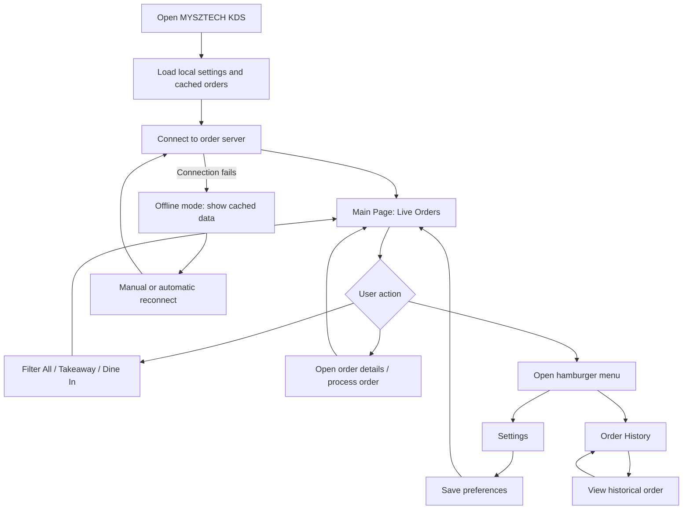
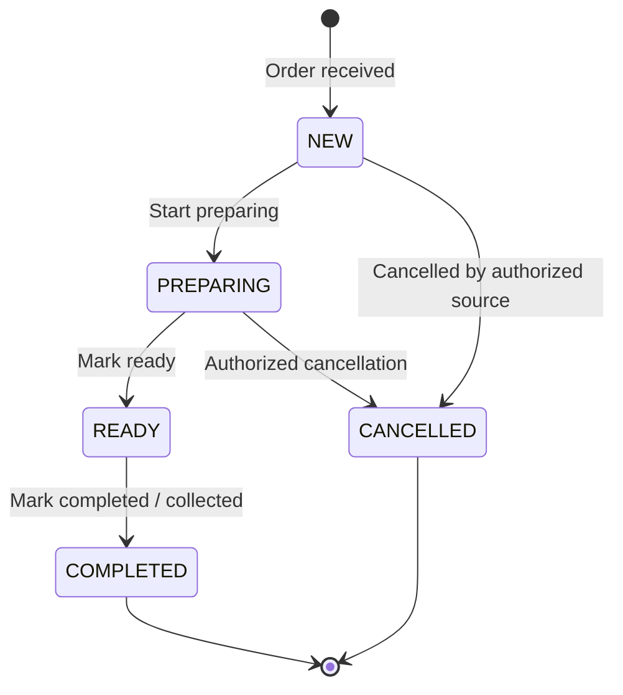
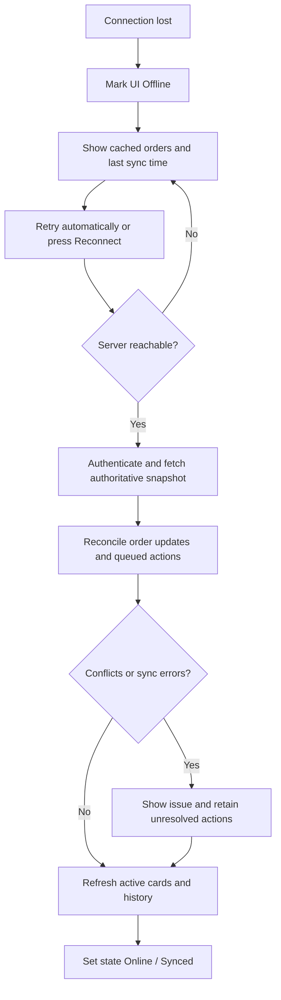

# MYSZTECH KDS — Application Structure & Functional Plan

> **Project:** MYSZTECH Kitchen Display System (KDS)  
> **Document type:** Application planning / screen specification / functional requirements  
> **Version:** 1.0 — 30 October 2026  
> **Primary reference:** Supplied KDS dashboard screenshot and handwritten structure notes  
> **Target experience:** Large-screen kitchen dashboard (desktop, tablet, or kiosk)

---

## 1. Purpose & Scope

The KDS displays restaurant orders received from an existing ordering/POS system so kitchen staff can read, prioritize, and process them quickly. The primary objective is **clarity during busy service**, not an overly complex dashboard.

### 1.1 Main objectives

1. Show incoming orders in near real time.
2. Separate orders by type, such as **All**, **Takeaway**, and **Dine In**.
3. Make order numbers, items, quantities, variants, modifiers, and remarks easy to read.
4. Show elapsed time and urgency with configurable **green → yellow → red** states.
5. Support a practical workflow for processing and completing orders.
6. Keep a searchable record of previously processed orders.
7. Continue showing cached orders during network interruptions and recover safely when connectivity returns.
8. Let authorized staff configure order display, order types/icons, timers, sounds, and connection behavior.

### 1.2 Reference vs. proposal

| Category | Included in the supplied reference | Proposed addition / decision required |
|---|---|---|
| Dashboard | Top app bar, active order count, MYSZTECH logo, hamburger menu | Connection badge and new-order notification |
| Filters | All / Takeaway / Dine In | Configurable visibility and count per type |
| Cards | Order number, time, order type, table, ordered by, order for, remarks, items, notes, timestamp | Clear processing actions and expanded details |
| Urgency | Green, yellow, red timer headers | Editable threshold values and alert behavior |
| Menu | Settings and Order History in handwritten notes | Connection status / About grouped under Settings |
| Offline | “Offline DB” and reconnect in handwritten notes | Explicit caching, action queue, recovery rules |

**Planning rule:** Keep the original design recognizable. Anything in the rightmost column is a recommended function, **not** a claim that the existing system already supports it.

---

## 2. Application Sitemap & Navigation

### 2.1 Navigation structure

```text
MYSZTECH KDS
│
├── MAIN PAGE / LIVE ORDERS                       [Default screen]
│   ├── App Bar
│   │   ├── Active Order Count
│   │   ├── MYSZTECH Logo
│   │   ├── Connection Status                       [Recommended]
│   │   └── Hamburger Menu
│   ├── Order Type Filters
│   │   ├── All
│   │   ├── Takeaway
│   │   └── Dine In
│   └── Live Order Cards
│       ├── Header: Order Number + Running Timer
│       ├── Order Details: Type, Table, Staff, Reference
│       ├── Remarks
│       ├── Items: Quantity, Variant, Modifier, Notes
│       ├── Order Timestamp
│       └── Order Actions                           [Recommended]
│
├── ORDER HISTORY
│   ├── Search / Filters
│   ├── Previous Orders List
│   └── Order Details
│
└── SETTINGS
    ├── Order Type Selection
    ├── Order Type Icons
    ├── Order Timer & Urgency Colors
    ├── Sound & Notifications                       [Recommended]
    ├── Display Preferences                         [Recommended]
    ├── Connection / Reconnect
    └── About

BACKGROUND SERVICES — NOT SEPARATE MAIN PAGES
├── Real-time Order Listener
├── Offline Local Database / Cache
├── Pending Action Sync Queue
└── Connection & Reconnection Monitor
```

**Important distinction:** An offline database is a **background service**, not a screen the kitchen worker must navigate to. “Reconnect” should primarily be a **connection action inside Settings**, with a compact status indicator on the dashboard.

### 2.2 User navigation flow



---

## 3. Main Page — Live Order Dashboard

### 3.1 Page sections

| Section | UI element | Function | Behavior |
|---|---|---|---|
| 1 | **App bar: order count** | Shows how many active orders exist | E.g., `Orders: 03`; update when data/status changes |
| 2 | **App bar: logo** | MYSZTECH branding | Center on wide screens; keep visible during navigation |
| 3 | **App bar: hamburger icon** | Opens the application menu | Menu items: Live Orders, Order History, Settings |
| 4 | **Connection indicator** | Shows Online / Reconnecting / Offline | Small but visible; recommended addition |
| 5 | **Type filter** | Filters active orders by type | All, Takeaway, Dine In; active option visually distinct |
| 6 | **Order cards area** | Shows live incoming kitchen orders | Responsive columns and scroll; avoid clipping long orders |
| 7 | **Empty state** | Indicates no active orders match the view | “No active orders” or “No takeaway orders” |
| 8 | **Loading/error state** | Handles initial loading and service failures | No blank dashboard or unexplained spinner |

### 3.2 Order count logic

- **Default:** count all active orders, regardless of which type filter is selected.
- **Optional:** show filter-specific counts on the filter buttons, e.g., `Takeaway (2)`.
- Exclude completed and cancelled orders from the active count.
- For consistency, define `active = NEW | PREPARING | READY` unless the POS contract uses other states.
- If a new order arrives while another filter is selected, update the overall count even if its card is hidden by that filter.

### 3.3 Order filter behavior

| Filter | Shows | Notes |
|---|---|---|
| **All** | All active order types enabled in Settings | Default selection |
| **Takeaway** | Active orders with the Takeaway type | Hidden if that type is disabled in display settings |
| **Dine In** | Active Dine In orders | Displays the table label where provided |

**Recommendation:** Show an “All” filter only if multiple order types are enabled; retain it for the reference design by default. Changing a display filter must **not** modify the orders themselves.

### 3.4 Order card layout

The screenshot uses a **receipt-like white card** on a dark background, with a colored timer header. Retain that visual hierarchy:

```text
┌───────────────────────────────────────────────┐
│ #567                    00:03:00  [GREEN]      │  ← Order number + elapsed time
├───────────────────────────────────────────────┤
│ 🍴 DINE IN                          Table T9  │  ← Type + table/destination
│───────────────────────────────────────────────│
│ Ordered by: Eman                              │
│ Order for: Order 9                            │
│ Remarks: Cepat                                │  ← Order-level remarks
│───────────────────────────────────────────────│
│ 2x  Nasi Goreng Pattaya                       │
│ 1x  Daging Black Pepper                       │
│ 1x  Limau Ais                                 │
│ 1x  Milo                                      │
│     Variant: COLD                             │
│     Modifiers: Kurang manis, kurang ais       │
│     Note: Nak kaw punya                       │
│                                               │
│ 28/10/2026                     12:09 PM       │  ← Order timestamp
│───────────────────────────────────────────────│
│ [Start Preparing] [Mark Ready / Complete]     │  ← Proposed actions
└───────────────────────────────────────────────┘
```

**Rendering rule:** Display optional lines only when data exists. Do not print blank variant/modifier/note rows or an artificial table number for Takeaway. Use `—` only if the field is important but truly absent.

### 3.5 Data displayed in an order card

| Field | Required? | UI treatment | Example |
|---|---|---|---|
| Internal order ID | Required internally | Not necessarily visible | `order_uuid` |
| Order number | Required | Largest identifier in top-left header | `#567` |
| Elapsed time | Required | Large text inside urgency-colored header | `00:05:00` |
| Order type | Required | Label and icon | `DINE IN`, `TAKEAWAY` |
| Table / destination | Conditional | Right-aligned beside order type | `Table T9` |
| Ordered by | Optional | Secondary metadata | `Eman` |
| Order for / reference | Optional | Secondary metadata | `Order 9` |
| Order remarks | Optional | Separate row above items | `Cepat` |
| Item quantity | Required | Bold before name | `2x` |
| Item name | Required | Bold, readable, wrap as needed | `Nasi Goreng Pattaya` |
| Item variant | Optional | Indented subline | `COLD` |
| Item modifiers | Optional | Indented subline / list | `Kurang manis`, `No taugeh` |
| Item notes | Optional | Indented subline; never silently truncate | `Nak kaw punya` |
| Created timestamp | Required | Bottom of card | `28/10/2026 12:09 PM` |
| Processing status | Recommended | Small state label or action region | `NEW`, `PREPARING`, `READY` |

**Avoid confusion:** `Order for` is a reference/recipient label, **not** the same thing as the timestamp. The screenshot demonstrates both.

### 3.6 Card sorting and responsive behavior

- Sort active orders **oldest first** by default, so long-waiting orders remain prominent.
- Make card height content-driven; an order with many items must expand or be internally scrollable without hiding the footer/action controls.
- Use a responsive grid rather than fixed card positions: around three cards on a large monitor, fewer on smaller screens.
- Avoid a carousel when the kitchen needs to see many active orders. If pagination is retained from the reference design, make page navigation obvious and notify staff when orders exist on other pages.
- Do not rely on green/yellow/red alone; the **elapsed time remains visible as text**.
- Use adequately large type and high contrast for viewing at a distance.

---

## 4. Order Timer & Urgency Logic

### 4.1 What the timer measures

The timer represents **elapsed time since the authoritative order creation/acceptance timestamp**, not time since a card was opened or the page last refreshed.

```text
elapsed_seconds = max(0, current_time - order_started_at)
```

Use a server-provided timestamp and a known clock offset where possible. The display should recalculate every second, but it does **not** require a server request every second.

### 4.2 Proposed default thresholds

The example screenshot shows roughly 3 minutes (green), 5 minutes (yellow), and 10 minutes (red). These are useful **initial configuration values**, not confirmed business rules.

| Elapsed time | Urgency | Header | Kitchen meaning |
|---|---|---|---|
| `00:00–04:59` | Normal | **Green** | Within expected time |
| `05:00–09:59` | Warning | **Yellow** | Needs attention |
| `10:00+` | Urgent | **Red** | Priority / long waiting |

### 4.3 Timer settings requirements

- Allow changing **Yellow starts at** and **Red starts at**, in minutes and/or seconds.
- Validate `0 < yellow_threshold < red_threshold`.
- Show an example preview of each color before saving.
- Apply changes to all live cards immediately after settings are saved.
- A timer's color is **not the order processing status**. For example, a `PREPARING` order can be red if it has waited too long.
- Decide whether completed orders stop the timer (recommended: store completion time and final duration).

---

## 5. Order Processing Workflow (Recommended)

The screenshot shows **display**, but not buttons for progressing an order. For a usable kitchen system, include a minimal processing workflow or confirm that statuses are handled entirely by the POS.

### 5.1 Suggested statuses



| Status | Dashboard | History | Possible action |
|---|---|---|---|
| `NEW` | Yes | No | Start Preparing |
| `PREPARING` | Yes | No | Mark Ready |
| `READY` | Yes, unless POS workflow says otherwise | No | Complete / Hand Off |
| `COMPLETED` | No | Yes | View details |
| `CANCELLED` | No | Yes | View cancellation reason |

### 5.2 Safeguards

- Show the action label clearly. Avoid accidental complete/cancel controls in a very busy kitchen.
- Confirm high-impact actions (especially cancellation or reopening).
- If multiple KDS terminals are open, sync order status across all terminals.
- Reject or reconcile stale actions (for example, an order was already completed elsewhere).
- Prevent duplicate status updates caused by rapid repeat taps.
- If the POS owns status transitions, **do not independently invent a second kitchen status system**; map the existing statuses into KDS instead.

---

## 6. Hamburger Menu & Settings

### 6.1 Hamburger menu

Suggested menu order:

```text
☰  MYSZTECH KDS
    ├── Live Orders
    ├── Order History
    ├── Settings
    └── Connection Status (Online / Offline)
```

Use a compact drawer/panel rather than navigating away from the dashboard merely to show connection status. Retain the MYSZTECH logo on the main app bar.

### 6.2 Settings overview

| Settings group | Setting | Function | Default / example |
|---|---|---|---|
| **Order Types** | Show Dine In | Display or hide Dine In filter/orders in this KDS view | On |
| | Show Takeaway | Display or hide Takeaway filter/orders in this KDS view | On |
| | Type label | Map backend type to readable label | `dine_in` → `DINE IN` |
| **Order Type Icons** | Show/hide icon | Toggle icon visibility beside type | On |
| | Icon mapping | Choose suitable icon for a type | Utensils / Shopping bag |
| **Order Timer** | Yellow threshold | Minutes before warning | `05:00` |
| | Red threshold | Minutes before urgent | `10:00` |
| | Preview | Preview live green/yellow/red colors | Three preview cards |
| **Sound** | New-order alert | Enable notification sound | On (proposed) |
| | Urgent-order alert | Alert when an order turns red | Optional |
| | Alert volume / test | Adjust and test sound | Device-supported behavior |
| **Display** | Font scale | Make receipts readable at distance | Normal / Large |
| | Card density | Comfortable vs compact order cards | Comfortable |
| | Order sorting | Oldest first / newest first | Oldest first |
| **Connection** | Connection status | Show current server state | Online |
| | Reconnect button | Retry server connection | Manual action |
| | Last synced time | Show last successful sync | Timestamp |
| **About** | App version | Show build/version information | `1.0.0` example |
| | Restaurant/device info | Show configured location/terminal ID | If supplied by system |

### 6.3 Order type selection details

The handwritten plan mentions **order type selection** and **order type icons**. These should be distinct controls:

1. **Type selection** decides **which categories this terminal displays**.
2. **Icon selection** decides **which visual icon represents each category**.

Examples:

- `Dine In` → utensils icon → show table number.
- `Takeaway` → bag icon → hide table field unless destination info exists.
- Additional types (e.g. Delivery) should be introduced **only if supported by the backend**, not hard-coded into an unsupported workflow.

If a type is hidden, its orders are only hidden from the **current view**; the order must not be deleted or falsely marked complete.

### 6.4 Sound settings details

Sound controls are useful in a noisy kitchen but should not become disruptive.

- Distinct optional sounds for **new order** and **urgent order**.
- One notification per **new unique order**, not every time the app reconnects or redraws.
- Prevent repeated alerts for the same urgency transition unless explicitly configured.
- Provide **Test Sound**, mute, and volume controls.
- Be aware that browsers may block automatic sound before a user interacts with the page; provide an “Enable sound” interaction on kiosk startup when needed.

### 6.5 Settings save behavior

- Load stored configuration when the app starts.
- Show only valid values in settings controls.
- Save immediately or via an explicit **Save Changes** button, with a clear success/error indication.
- Keep shared restaurant-wide settings separate from per-device preferences if multiple terminals exist.
- Define access permissions: ordinary kitchen users may view or change local display/sound preferences; timer thresholds and shared settings may require a manager role.

---

## 7. Order History

### 7.1 Purpose

Allow staff to review **completed and cancelled orders** without crowding the live dashboard.

### 7.2 Screen structure

```text
ORDER HISTORY
├── Search: order number / table / keyword
├── Filters: date range, order type, final status
├── Order list
│   ├── Order number, type, table/destination
│   ├── Created time
│   ├── Completed/cancelled time
│   └── Final status
└── Order detail
    ├── Complete original items, modifiers, notes
    ├── Remarks
    ├── Status timeline (if available)
    └── Duration / completion information
```

### 7.3 History rules

- Prefer server data as the authoritative history; use local cache for recently viewed entries if offline.
- Do not call local cache a complete historic archive unless all relevant past orders are actually synchronized.
- New active orders must not appear in history just because the current display filter hides them.
- Historical orders should be **read-only** by default. Reopen requires permissions and explicit backend support.
- Use paging or virtual scrolling for large volumes.

---

## 8. Offline Database, Reconnect & Synchronization

### 8.1 Connection states

| State | UI text | App behavior |
|---|---|---|
| **Online** | `Connected` | Receive updates in real time; send valid actions |
| **Reconnecting** | `Reconnecting…` | Keep existing cards visible; retry connection |
| **Offline** | `Offline — showing cached orders` | Read local snapshot; clearly warn it may be outdated |
| **Syncing** | `Syncing changes…` | Refresh orders and reconcile queued valid changes |
| **Sync error** | `Sync needs attention` | Explain what failed and allow retry |

### 8.2 Offline behavior

**What the app can do offline:**

- Display orders previously downloaded and saved locally.
- Preserve locally stored display settings.
- Continue elapsed timer calculations for cached orders, while identifying that data may be stale.
- Optionally queue permitted order-status actions, **only when the server API supports safe reconciliation**.

**What it cannot guarantee offline:**

- Receiving brand-new orders created on another device/server while there is no connection.
- Knowing whether another terminal has changed, completed, or cancelled a cached order.
- Successfully completing a server-side action until it has been acknowledged after reconnection.

### 8.3 Reconnect flow



### 8.4 Synchronization requirements

1. Use a stable **internal order ID** to match orders. Do **not** rely on the visible order number alone; the reference screenshot repeats `#567` across three example cards.
2. Support incremental updates or fetch a full authoritative snapshot after reconnect.
3. Avoid duplicate cards when a real-time event and API refresh contain the same order.
4. If offline status actions are allowed, assign each queued action a unique idempotency key.
5. Never silently overwrite a newer server state with an older cached state.
6. If a queued action is rejected, display the conflict rather than claiming success.
7. Display `Last synced: HH:MM` when offline.
8. Use a retention policy for cached historical data and protect locally stored sensitive information.

**Implementation note:** For a web KDS, **IndexedDB** is a reasonable local database option. For a native app, **SQLite** may fit better. The storage library is a technology decision, not a user-visible KDS page.

---

## 9. Data Model (Logical, Backend-Agnostic)

### 9.1 Order object

```json
{
  "id": "order-20261028-000567-A",
  "order_number": "567",
  "order_type": "DINE_IN",
  "table_label": "T9",
  "ordered_by": "Eman",
  "order_for": "Order 9",
  "remarks": "Cepat",
  "status": "NEW",
  "created_at": "2026-10-28T12:09:00+08:00",
  "updated_at": "2026-10-28T12:09:00+08:00",
  "items": [
    {
      "id": "line-1",
      "name": "Nasi Goreng Pattaya",
      "quantity": 2,
      "variant": null,
      "modifiers": [],
      "notes": null
    },
    {
      "id": "line-2",
      "name": "Milo",
      "quantity": 1,
      "variant": "COLD",
      "modifiers": ["Kurang manis", "Kurang ais"],
      "notes": "Nak kaw punya"
    }
  ],
  "version": 1
}
```

**Notes:** Sample schema only; align field names with the actual POS/backend API. `table_label` may be null for Takeaway. A single order can contain many items. A line item can have zero or many modifiers. Do not combine order-level remarks with item-level notes.

### 9.2 Additional logical objects

| Object | Important fields | Purpose |
|---|---|---|
| `Order` | `id`, `order_number`, `order_type`, `status`, times, remarks | Active + historical order |
| `OrderItem` | `id`, `order_id`, `quantity`, `name`, `variant`, modifiers, notes | Item-level receipt details |
| `KdsSettings` | visible types, icon map, thresholds, sound, display preferences | Configurable KDS behavior |
| `ConnectionState` | status, `last_synced_at`, error | Connection UI |
| `PendingAction` | action ID, order ID, previous version, target status, created time | Optional offline status queue |
| `StatusEvent` | order ID, from/to status, actor, timestamp | Auditing/history if backend supports it |

### 9.3 Recommended integration boundaries

```text
Ordering System / POS / Backend
            │
            ├── HTTP API: initial order list, history, settings, actions
            └── Real-time channel: new/updated/cancelled orders
                              │
                        KDS Application
                              │
                 ┌────────────┼────────────┐
                 │            │            │
           Order Store   Local Cache   Settings Store
                 │            │            │
                 └────────────┼────────────┘
                              │
                     Live Dashboard UI
```

- Use a real-time transport the backend already supports (for example, WebSocket or Server-Sent Events); optionally use polling as a fallback.
- Authenticate the terminal/API requests according to the existing backend design.
- Do not hard-code secrets or administrative credentials in the KDS frontend.
- Ask backend owners for exact order/status contracts before implementing status-changing actions.

---

## 10. Suggested Frontend Module Structure

This is a **feature-first structure**, deliberately kept lightweight. Names are illustrative, not a mandate to choose a framework.

```text
src/
├── app/
│   ├── app_entry
│   ├── router
│   └── app_config
│
├── features/
│   ├── live_orders/
│   │   ├── main_page
│   │   ├── order_filter
│   │   ├── order_card
│   │   ├── order_detail
│   │   └── order_actions
│   ├── order_history/
│   │   ├── history_page
│   │   └── history_detail
│   └── settings/
│       ├── settings_page
│       ├── order_type_settings
│       ├── timer_settings
│       ├── sound_settings
│       └── display_settings
│
├── shared/
│   ├── components/           # app_bar, drawer, badges, dialogs
│   ├── models/               # order, order_item, settings
│   └── utils/                # timers, formatting, validation
│
├── services/
│   ├── order_api
│   ├── realtime_connection
│   ├── local_database
│   ├── sync_service
│   └── notification_service
│
└── assets/
    ├── branding/
    ├── icons/
    └── sounds/
```

**Guidelines:**

- Reuse one `order_card` component for all order types, with data-driven labels and icons.
- Keep timer calculations and status/urgency mapping outside the visual component.
- Keep API and local database access out of page widgets/components.
- Keep KDS settings centralized so changing an option updates the relevant components consistently.
- Do not add unnecessary domain layers, repositories, managers, or state machines until actual complexity requires them.

---

## 11. UI / UX Rules Based on the Reference

| Area | Recommendation |
|---|---|
| Visual theme | Keep **dark navy background** and **white receipt cards** as the dominant contrast |
| Branding | Use existing MYSZTECH logo and brand accents; avoid overdecorating the functional order area |
| Order number | Large, bold, white-on-black area in the card header |
| Timer | Large digits with high contrast; green/yellow/red header with readable text |
| Type | Icon + textual label; never icon-only |
| Items | Bold item name and quantity; modifiers/notes indented underneath |
| Remarks | Visually distinct from item modifiers so the kitchen can distinguish scope |
| Timestamp | Show created date/time clearly; do not substitute it for the running timer |
| Actions | If included, place consistently; prevent accidental taps |
| Information overflow | Wrap text, expand card, or support details; never silently omit instructions |
| Accessibility | Readable font scale, logical focus order, keyboard/touch support, no color-only information |
| Connectivity | Warning always visible when offline; avoid giving false sense that orders are current |

**Card density recommendation:** Start with a comfortable three-column layout on a wide display. Validate with actual kitchen staff at real viewing distance before locking typography and card widths.

---

## 12. MVP Priority & Delivery Plan

### Phase 1 — Core Live KDS (MVP)

- [ ] Render app bar, order count, logo, hamburger menu.
- [ ] Receive and list orders from backend or test fixture.
- [ ] Build responsive receipt-style order cards using real item/remark structures.
- [ ] Implement All / Takeaway / Dine In filters.
- [ ] Implement elapsed timer and green/yellow/red configurable thresholds.
- [ ] Provide empty, loading, failure, and disconnected states.
- [ ] Verify order updates do not duplicate or lose cards.
- [ ] Define whether statuses are display-only or actionable from KDS.

### Phase 2 — Operational Features

- [ ] Implement order processing actions, **if authorized by the backend workflow**.
- [ ] Build Order History with search and filters.
- [ ] Build Settings for order type visibility and icons.
- [ ] Add timer configuration and preview.
- [ ] Add sound notifications and test control.
- [ ] Add display preferences and About information.

### Phase 3 — Reliability / Offline

- [ ] Cache the latest known order snapshot locally.
- [ ] Show offline state and last synchronization timestamp.
- [ ] Support automatic retries and a manual Reconnect button.
- [ ] Refresh and reconcile authoritative orders after reconnect.
- [ ] Queue offline actions **only if supported safely** by the backend.
- [ ] Test duplicate events, stale updates, errors, and multiple terminals.

---

## 13. Key Acceptance Test Scenarios

| ID | Scenario | Expected result |
|---|---|---|
| KDS-01 | New Dine In order arrives | New card appears with type icon, table, count update, and timer |
| KDS-02 | New Takeaway order arrives | Appears in All and Takeaway, not Dine In |
| KDS-03 | Item has variant, modifier, and note | All three render distinctly under the correct item |
| KDS-04 | Order has a long remark / 15+ items | No important instruction or action is clipped |
| KDS-05 | Timer crosses 5-minute threshold | Card changes from green to yellow based on settings |
| KDS-06 | Timer crosses 10-minute threshold | Card changes to red without refreshing the page |
| KDS-07 | Browser/app restarts | Elapsed timer resumes based on order timestamp, not zero |
| KDS-08 | Order completed on another terminal | Current KDS updates/removes it from live list appropriately |
| KDS-09 | Duplicate event received | Order appears only once |
| KDS-10 | Network disconnects | Cached orders stay visible with explicit offline warning |
| KDS-11 | Connection returns | Current authoritative orders sync without duplicates |
| KDS-12 | Hidden order type selected in Settings | Corresponding view hides without deleting backend orders |
| KDS-13 | Timer threshold invalid | Settings reject change and show useful validation message |
| KDS-14 | New-order sound enabled | One appropriate alert per new unique order, subject to device/browser sound permission |
| KDS-15 | History opened | Completed orders can be found and inspected |
| KDS-16 | Visible order numbers repeat | Internal IDs keep the records distinct |

---

## 14. Decisions to Confirm Before Development

These are the questions that will materially change the implementation; the reference images do not fully answer them.

1. **Source of orders:** Which existing POS/backend API or database provides orders? Is there already a real-time event stream?
2. **Processing authority:** Will kitchen staff change status on the KDS, or is the screen display-only?
3. **Supported order types:** Only Dine In and Takeaway, or others configured by the backend?
4. **Timer start:** Is elapsed time measured from POS order creation, kitchen acceptance, or another defined event?
5. **Offline actions:** Should users be allowed to mark orders complete while offline, or should offline mode be read-only?
6. **Settings scope:** Are timer thresholds shared across the restaurant, or customizable separately on each device?
7. **History retention:** How long should order history remain available, and is it server-hosted?
8. **Target runtime:** Browser kiosk / PWA, tablet application, or desktop application?

**Recommended default for first implementation:** A large-screen **display-first KDS** using the existing POS order contract, with configurable filters/timers, explicit connection health, and read-only offline cache. Add status-changing actions once backend behavior and conflict rules are confirmed.

---

## 15. Summary of What to Build

| Module | Core responsibility | Priority |
|---|---|---|
| Main Page | Live orders, filters, timer, readable receipt cards | **Essential** |
| Order Cards | Order number/type, item details, variants, modifiers, remarks, timestamp | **Essential** |
| Timer Engine | Compute elapsed time and green/yellow/red urgency | **Essential** |
| Order Actions | Progress order statuses if backend allows | **Decision required** |
| Settings | Order types/icons, timer rules, optional sound/display controls | **High** |
| Order History | View/search previous orders | **High** |
| Offline Local Cache | Preserve last known orders while disconnected | **High** |
| Reconnect & Sync | Restore fresh server data, resolve updates/conflicts | **High** |

**Design principle:** **Fast to scan, difficult to misread, resilient to poor connectivity, and easy to configure without making the kitchen workflow complicated.**
