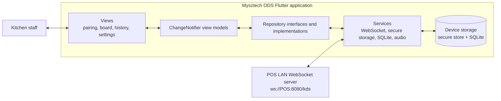
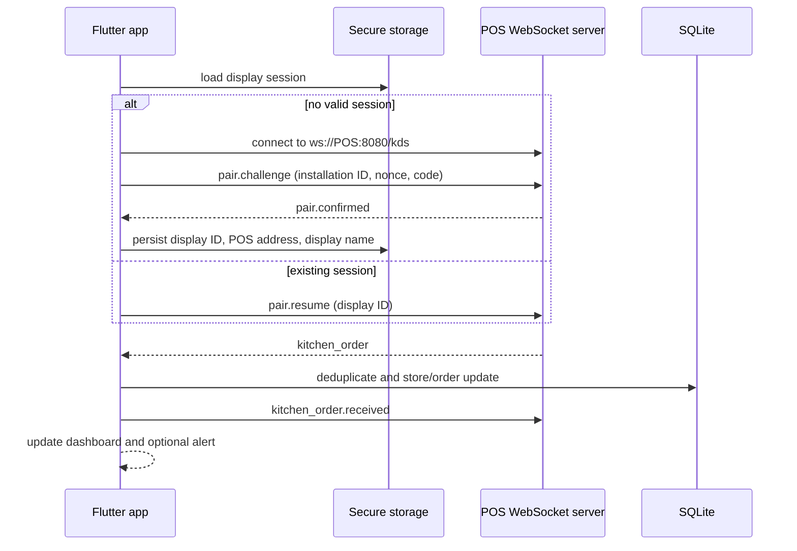

# Mysztech ODS project guide

## Purpose and scope

Mysztech ODS is a Flutter kitchen display system (KDS) for an outlet's local
network. It is a display-first client: the POS remains the authority for order
creation, routing, amendment, and cancellation. ODS receives structured orders
from the POS, stores them locally, and makes them easy for kitchen staff to
read and manage on a large screen.

This guide describes the behaviour implemented in this repository. It does not
promise POS/backend capabilities that are only described in planning documents.

## Contents

- [System architecture](#system-architecture)
- [Functional behaviour](#functional-behaviour)
- [POS LAN protocol](#pos-lan-protocol)
- [Local data, privacy, and network security](#local-data-privacy-and-network-security)
- [Repository structure](#repository-structure)
- [Run, test, and build](#run-test-and-build)
- [Testing and contribution workflow](#testing-and-contribution-workflow)
- [Operations and troubleshooting](#operations-and-troubleshooting)
- [Known gaps and decisions to confirm](#known-gaps-and-decisions-to-confirm)

## System architecture



The code uses an explicit three-layer arrangement:

| Layer | Location | Responsibility |
| --- | --- | --- |
| Presentation | `lib/ui/` | Flutter widgets, app theme, navigation, and UI-only interaction. |
| View-model state | `lib/ui/**/view_models/` | `ChangeNotifier` state, user actions, timers, filtering, paging, and UI-facing errors. |
| Domain | `lib/domain/models/` | Immutable session, pairing, order, item, type, and settings models. |
| Data | `lib/data/` | Repository contracts/implementations and platform/network/storage services. |
| Composition root | `lib/app_dependencies.dart`, `lib/main.dart` | Creates concrete dependencies and injects view models into the widget tree. |

`AppDependencies` owns the concrete object graph. Widgets receive the view
models they need; they do not create databases, WebSocket clients, repositories,
or platform services themselves.

### Startup and runtime flow



Once a connection has been established, a closed socket is reopened after 1,
2, 4, 8, 16, then 32 seconds; subsequent retries remain at 32 seconds. A
manual **Reconnect** button is available in Display settings. Initial
connection failures are surfaced to the dashboard and require a retry.

## Functional behaviour

### Pairing and connection

1. On a new device, the user enters a POS LAN address and a display name
   (maximum 120 characters).
2. ODS creates or reuses a stable local installation UUID, opens
   `ws://<address>:8080/kds`, and shows a fresh six-digit pairing code.
3. An operator approves the request in the POS. ODS accepts only a
   `pair.confirmed` message using protocol `kitchen-order.v1` and then stores
   the display session in secure storage.
4. On later launches, ODS sends `pair.resume` using the stored display ID.
5. Changing the POS connection clears the local session and returns the app to
   pairing. It does not delete SQLite order/history data.

### Live kitchen board

- Orders are grouped into one visual receipt per `(saleId, orderNumber)`; the
  underlying storage identity is `(saleId, departmentId)`.
- Filter chips are built from POS-provided order types. **All** is always
  available, and hidden types disappear from both filters and the board.
- The board sorts oldest first by default; the display setting can select newest
  first. It pages receipts according to available screen space.
- A receipt includes its number, elapsed timer, type and icon, table, orderer,
  recipient, remarks, line items, variants, modifiers, item comments, and
  entered/created time when supplied.
- Timer colour is green before the warning threshold, yellow from the warning
  threshold, and red from the urgent threshold. Defaults are 05:00 and 10:00.
- Tapping a line item only crosses it off in memory. Crossing every item marks
  the receipt finished locally.
- Tapping a receipt header also marks it finished locally. A configurable
  1–300 second grace period (default 10 seconds) offers Undo before it leaves
  the live board.

### History and local completion

Finished receipts are retained in the device's same-day Order History. A user
can inspect a receipt or retrieve it back to the live board; retrieved receipts
are labelled as such. These actions update only local SQLite state—no kitchen
workflow status is sent to the POS or a backend.

An amended POS order with a newer revision supersedes the stored receipt. If it
was previously finished locally, it reappears on the board as active work.

### Display settings

Settings are local to the display and save automatically. They include:

- visibility and icon for received order types;
- yellow/red timer thresholds and finished-receipt delay;
- large text, compact cards, and newest-first ordering;
- one-time new-order and urgent-order alerts, including tone selection and
  test controls;
- current POS connection status, reconnect, and change-connection controls;
- display name, display ID, and application version.

Android uses an in-app native tone generator for the alert templates. Other
platforms use Flutter's best-effort system-sound fallback; an unavailable sound
channel never blocks order rendering.

## POS LAN protocol

The app is a WebSocket client; it does not call Laravel/backend ticket endpoints
and does not store a Laravel bearer token. The complete intended POS/backend
context is in [`lib/docs/KITCHEN_DISPLAY_API.md`](../lib/docs/KITCHEN_DISPLAY_API.md).
The following is the contract the Flutter client currently implements.

### Endpoint and pairing messages

The endpoint is fixed in code to `ws://<pos-address>:8080/kds`.

ODS sends a `pair.challenge` immediately after a new pairing socket connects:

```json
{
  "type": "pair.challenge",
  "display_id": "stable-installation-uuid",
  "name": "Main Kitchen",
  "nonce": "cryptographically-random-url-safe-value",
  "code": "483921",
  "capabilities": {
    "app_version": "1.0.0",
    "protocol": "kitchen-order.v1"
  }
}
```

The POS confirms it with:

```json
{
  "type": "pair.confirmed",
  "display_id": "paired-display-id",
  "protocol": "kitchen-order.v1"
}
```

After an established display reconnects, it sends:

```json
{
  "type": "pair.resume",
  "display_id": "paired-display-id",
  "protocol": "kitchen-order.v1"
}
```

The POS must re-authorize the resumed connection before sending orders. The
client considers the connection paired only after receiving `pair.confirmed`.

### Required order message fields

ODS considers a message an order only when `type` is `kitchen_order` and
`protocol` is `kitchen-order.v1`. It requires these fields:

| Field | Type / rule | Purpose |
| --- | --- | --- |
| `message_id` | non-empty string | Transport deduplication key. |
| `sale_id`, `department_id` | non-empty strings | Persistent ticket identity. |
| `revision` | integer, at least 1 | Prevents an older update replacing a newer ticket. |
| `action` | `upsert` or `cancel` | Creates/replaces or removes the local active ticket. |
| `order_number` | integer | Human-readable receipt number. |
| `created_at` | parseable ISO-8601 date/time | Starts the elapsed timer. |
| `items` | list | An empty list is valid; the field must be present. |

Each item requires `name` (non-empty string) and `quantity` (number). It may
also include `comments`, `variant`, and `modifiers` (a list of strings).

Optional display fields are `table_name`, `order_name`, `staff_name` (or
`staff`), `ordered_by`, `order_for`, `remarks`, `entered_at`, and
`order_type: { "id": "…", "name": "…" }`. A message can additionally carry
`order_types`, a list of `{id, name, icon}` objects used to populate local
filters and settings.

Example supported payload:

```json
{
  "type": "kitchen_order",
  "protocol": "kitchen-order.v1",
  "message_id": "b3f2574c-3de6-4c86-9fe5-8c9f882fe2af",
  "sale_id": "sale-191",
  "department_id": "hot-kitchen",
  "revision": 2,
  "action": "upsert",
  "order_number": 104,
  "created_at": "2026-11-10T10:30:00+08:00",
  "order_type": {"id": "dine-in", "name": "Dine in"},
  "order_types": [{"id": "dine-in", "name": "Dine in", "icon": "table_restaurant"}],
  "table_name": "12",
  "staff_name": "Syad",
  "remarks": "No peanuts",
  "items": [
    {
      "name": "Chicken Rice",
      "quantity": 2,
      "variant": "Large",
      "modifiers": ["No chilli"],
      "comments": "Serve separately"
    }
  ]
}
```

After a valid message is durably processed, ODS sends:

```json
{
  "type": "kitchen_order.received",
  "message_id": "b3f2574c-3de6-4c86-9fe5-8c9f882fe2af",
  "received_at": "2026-11-10T02:30:01.000Z"
}
```

Malformed messages are ignored and are not acknowledged. Reusing a processed
`message_id` cannot create another ticket, and an update with a revision less
than or equal to the stored revision cannot replace it.

### Integration compatibility notes

- The published integration document's sample uses `variant_options`; the
  Flutter model currently renders `variant`. POS senders need to provide
  `variant` until the client or contract is aligned.
- The Flutter endpoint is always plain `ws` on port 8080. The API document
  discusses `wss`, but this client has no TLS/port configuration yet.
- A `cancel` message must still meet the model's required fields, including
  `created_at` and `items`, even though it is removed from the active board.
- There is no durable outgoing queue for completion actions because completion
  is deliberately local-only. `sync_state` and `pending_actions` tables exist
  in the schema but are not used by the present client.

## Local data, privacy, and network security

| Store | Contents | Behaviour |
| --- | --- | --- |
| `flutter_secure_storage` | Stable installation UUID and display session (`display_id`, POS address, display name) | Used to resume pairing after restart. |
| SQLite `tickets` | Latest ticket payload, revision, local status, update time | Retains active, retrieved, finished, and cancelled ticket data locally. |
| SQLite `processed_messages` | Processed WebSocket message IDs | Enables duplicate-safe delivery acknowledgement. |
| SQLite `order_types` | Locally received type names and selected icons | Lets staff configure locally displayed order types. |
| SQLite `display_settings` | Local timer, layout, filter, and sound preferences | One JSON settings document per device. |

No POS/backend credential is stored in this app. However, kitchen-ticket data
is stored locally and can contain customer/order details. Deploy on managed,
access-controlled devices and define an operational retention/reset process.

Android grants `INTERNET` and enables clear-text traffic so it can reach the
current `ws://` LAN endpoint. This is appropriate only for a controlled outlet
network. Do not expose the POS WebSocket to the public internet. Moving to
`wss://`, certificate validation, and configurable endpoint/port should be a
separate security hardening change.

## Repository structure

```text
.
├── lib/
│   ├── main.dart                         # Flutter bootstrap
│   ├── app_dependencies.dart             # Concrete dependency composition
│   ├── domain/models/                    # Session, order, pairing, settings models
│   ├── data/
│   │   ├── repositories/                 # Data boundaries and implementations
│   │   └── services/                     # WebSocket, SQLite, secure storage, audio
│   ├── ui/core/                          # App shell, branding, theme primitives
│   └── ui/features/
│       ├── session/                      # Startup/session routing
│       ├── pairing/                      # Pairing view and state
│       └── kitchen/                      # Board, history, settings, board state
├── test/                                 # Mirrors lib/ by feature/layer
├── assets/images/                        # Logo, background, app artwork
├── android/                              # Android runner + native alert channel
├── windows/                              # Windows runner
├── web/                                  # Web runner/PWA shell
├── docs/                                 # Product plan and this guide
├── lib/docs/                             # Existing integration and delivery documents
├── pubspec.yaml                          # SDK range, dependencies, assets, version
└── analysis_options.yaml                 # Flutter lint configuration
```

## Run, test, and build

### Prerequisites

- Flutter SDK with Dart **3.11 or newer** (`pubspec.yaml` declares `^3.11.0`).
- Run `flutter doctor` and install the toolchain for the target you choose.
- Java 17 for Android builds (the Gradle project targets Java 17).
- A reachable POS LAN WebSocket service for end-to-end pairing and order tests.

The repository contains Android, Windows, and web runners. Android is the
runtime with the custom native alert channel. Before using Windows or web as a
production KDS, validate the full local-storage workflow on that target: the
project declares `sqflite` but does not include a Windows or web SQLite adapter.
The Flutter runner compiling is not proof that pairing, persistence, and order
delivery work end to end on that platform.

### Local development

```powershell
# Install locked package versions.
flutter pub get

# Run static checks and the complete test suite.
flutter analyze
flutter test

# Launch on an available target.
flutter run -d windows
flutter run -d chrome
flutter run -d <android-device-id>
```

Use `flutter devices` to list target IDs. For a focused test, pass the test
file path, for example:

```powershell
flutter test test/ui/features/kitchen/view_models/kitchen_board_view_model_test.dart
```

After changing Dart source, format it before validation:

```powershell
dart format .
flutter analyze
flutter test
```

### Production artefacts

```powershell
flutter build apk --release
flutter build windows --release
flutter build web --release
```

The Android release build currently uses the debug signing configuration in
`android/app/build.gradle.kts`. Configure a protected production keystore and
release signing before distributing an APK. If hosting a web build over HTTPS,
a browser may reject the app's plain `ws://` connection as mixed content; use a
compatible secure transport before production web deployment.

## Testing and contribution workflow

The automated tests cover domain parsing/settings, repositories, local service
behaviour, app dependency composition, view-model behaviour, and selected
widgets. Tests use Flutter's built-in `flutter_test` package and are organised
to mirror the source tree.

When changing the app:

1. Inspect the affected model, service/repository boundary, view model, caller,
   and matching tests before editing.
2. Preserve the separation between UI, state, and data access. Inject new
   dependencies through `AppDependencies` rather than constructing them in a
   widget.
3. Add focused tests for changed non-trivial behaviour.
4. Run `dart format .`, `flutter analyze`, and `flutter test`.
5. For POS protocol changes, update this guide and
   `lib/docs/KITCHEN_DISPLAY_API.md` together, then test against a real POS.

Use PascalCase for types/widgets, camelCase for members, and `snake_case.dart`
for Dart filenames. The project uses `flutter_lints` through
`analysis_options.yaml`.

## Operations and troubleshooting

| Symptom | Checks and recovery |
| --- | --- |
| No pairing code appears | Check the POS address, that the POS listener is at port 8080/path `/kds`, LAN routing/firewall rules, and that the POS is reachable from the display. Cancel and retry after correcting it. |
| Pairing never completes | Approve the code in the POS before the 10-minute pairing timeout. Confirm the POS emits the exact `pair.confirmed` message and protocol string. |
| Dashboard says reconnecting | Confirm outlet Wi-Fi/LAN and POS availability. Use **Settings → Reconnect** after the POS is available; the app also retries after a dropped established socket. |
| Connected but no orders | Confirm POS department/display routing, `kitchen-order.v1`, paired display authorization, and every required order field. Inspect POS delivery logs for the matching `message_id` acknowledgement. |
| Duplicate or stale receipts | Ensure the POS preserves `message_id` for retries and increments `revision` for amendments. ODS ignores duplicate IDs and non-increasing revisions by design. |
| No alert sound | Turn on the relevant setting, test its selected tone, and check device volume. Custom templates are Android-only; other targets use a non-blocking fallback. |
| Finished receipt is missing | It appears in this display's Order History for the current day. Retrieve it from history if it needs to return to the board. |

For development diagnostics, run with `flutter run -d <device>` and inspect the
POS server's delivery logs. Do not log pairing nonces/codes, credentials, or
full customer ticket payloads in production.

## Known gaps and decisions to confirm

- Confirm the POS server's `pair.resume` semantics and real-world reconnect
  behaviour.
- Align the `variant` versus `variant_options` wire field before integration.
- Decide whether KDS should ever report preparation/completion status to POS;
  it does not today.
- Add secure WebSocket transport, endpoint configuration, and certificate
  handling before any untrusted-network deployment.
- Validate SQLite persistence and WebSocket behaviour on each non-Android
  target before calling it a supported operational platform.
- Define local order-history retention, data erasure, device reset, and POS
  incident procedures for production outlets.

## Related material

- [`README.md`](../README.md) is the concise project entry point.
- [`lib/docs/KITCHEN_DISPLAY_API.md`](../lib/docs/KITCHEN_DISPLAY_API.md)
  contains the broader POS/backend contract and should be maintained by both
  integration sides.
- [`docs/MYSZTECH_KDS_App_Structure_and_Functions.md`](MYSZTECH_KDS_App_Structure_and_Functions.md)
  captures product intent and proposed capabilities. Treat its proposed items
  as roadmap material, not as a statement of implemented functionality.
- [`lib/docs/KITCHEN_DISPLAY_DEVELOPMENT_PLAN.md`](../lib/docs/KITCHEN_DISPLAY_DEVELOPMENT_PLAN.md)
  is useful historical context but includes an earlier cloud/REST approach that
  differs from the current LAN WebSocket implementation.
